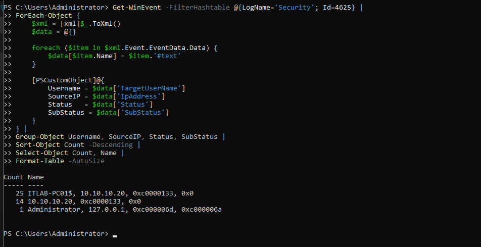
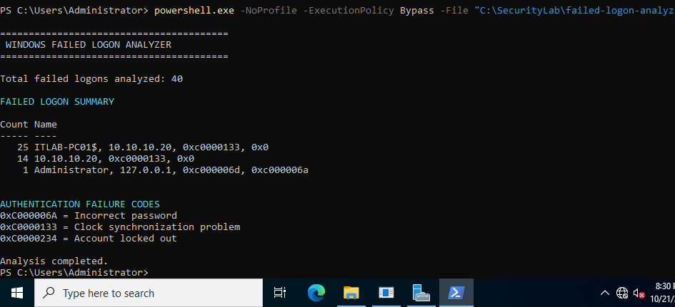
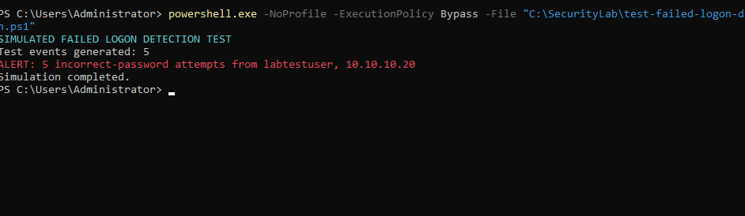
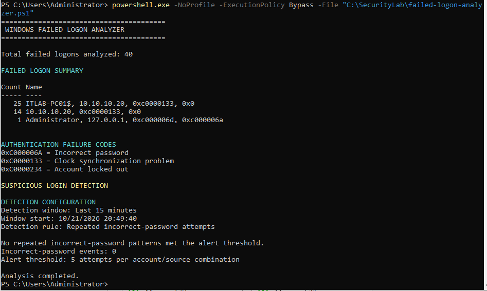
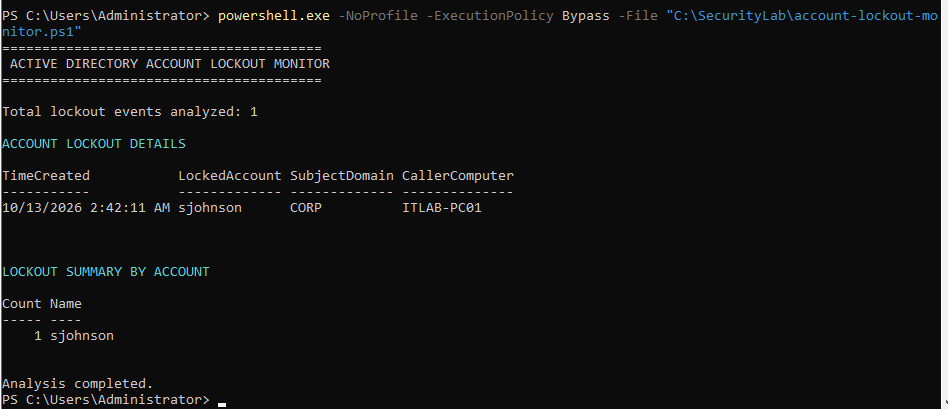
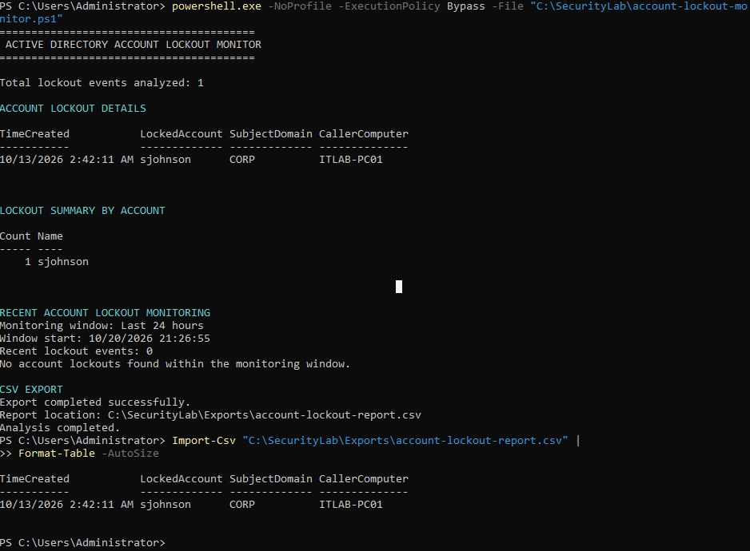

# Windows Security Log Monitoring & Threat Detection Lab

**Active Directory | Windows Server 2022 | PowerShell | SOC Analysis | Threat Detection**

## Project Overview

This project demonstrates hands-on Windows Security log monitoring, Active Directory account-lockout investigation, and PowerShell-based authentication threat detection in an isolated enterprise-style lab.

I investigated Windows authentication events, correlated password-management activity with an account lockout, developed reusable PowerShell monitoring scripts, and validated threshold-based alerting using synthetic authentication events.

The project emphasizes evidence-based investigation, distinguishing security threats from infrastructure problems, and documenting findings professionally.

## Lab Environment

| Component | Configuration |
|---|---|
| Virtualization | Oracle VirtualBox |
| Domain Controller | ITLAB-DC01 — Windows Server 2022 |
| Domain-Joined Workstation | ITLAB-PC01 — Windows 11 |
| Active Directory Domain | corp.itlab.test |
| Domain Controller IP | 10.10.10.10 |
| Workstation IP | 10.10.10.20 |
| Tools | Event Viewer, PowerShell, Active Directory |

## Project Objectives

- Investigate Windows authentication failures and account lockouts.
- Analyze Security Event IDs 4624, 4625, 4723, 4724, 4738, and 4740.
- Examine account creation and group membership changes.
- Correlate events across a domain controller and workstation.
- Develop PowerShell scripts for security log analysis.
- Detect repeated incorrect-password attempts.
- Implement time-window-based monitoring.
- Export investigation results to CSV.
- Document findings and validate detection logic.

## Key Investigation Findings

### 1. Authentication Failure Analysis

Using PowerShell, I analyzed 40 Windows Security Event ID 4625 records.

| Finding | Events |
|---|---:|
| Clock synchronization failures (0xC0000133) | 39 |
| Incorrect-password failures (0xC000006A) | 1 |
| **Total** | **40** |

The clock-related failures were associated with the domain-joined workstation at `10.10.10.20`.

This demonstrated the importance of interpreting Windows authentication failure codes before classifying repeated failures as suspicious activity.

### 2. Active Directory Account Lockout Investigation

Investigated a lockout involving the domain account `sjohnson`.

| Timestamp — October 13, 2026 | Event ID | Finding |
|---|---|---|
| 12:49:55 AM | 4724 | Administrator successfully attempted a password reset |
| 2:39:29 AM | 4723 | User successfully changed their password |
| 2:39:29 AM | 4738 | Account-change event recorded |
| 2:42:11 AM | 4740 | Account locked out; caller computer ITLAB-PC01 |

The account lockout occurred approximately 2 minutes and 42 seconds after the recorded password change.

A stale-credential authentication issue was considered as a possible explanation, but the root cause could not be confirmed from the available evidence.

**Investigation report:** [Account Lockout Investigation](reports/sjohnson-account-lockout-investigation.md)

### 3. PowerShell Failed-Logon Detection

Developed a PowerShell analyzer that:

- Retrieves Windows Security Event ID 4625 records.
- Extracts usernames, source IP addresses, and failure codes.
- Groups authentication failures.
- Identifies repeated incorrect-password attempts.
- Applies a configurable 15-minute detection window.
- Displays threshold-based alerts.

**Script:** [Failed Logon Analyzer](scripts/failed-logon-analyzer.ps1)

### 4. Detection Validation

Tested the detection logic using five synthetic incorrect-password records for a dedicated test identity.

The simulation generated the expected alert:

```text
SIMULATED FAILED LOGON DETECTION TEST
Test events generated: 5
ALERT: 5 incorrect-password attempts from labtestuser, 10.10.10.20
Simulation completed.
```

The simulation did not perform actual login attempts or modify Active Directory accounts.

**Test script:** [Simulated Detection Test](scripts/test-failed-logon-detection.ps1)

**Validation report:** [Threat Detection Validation](reports/powershell-threat-detection-validation.md)

### 5. Automated Account Lockout Monitoring

Developed a PowerShell script to analyze Event ID 4740.

The script provides:

- Historical account lockout records.
- Locked account names and timestamps.
- Associated caller computers.
- Lockout counts by account.
- Configurable 24-hour monitoring.
- CSV export for further investigation.

**Script:** [Account Lockout Monitor](scripts/account-lockout-monitor.ps1)

**Exported report:** [Account Lockout CSV](reports/account-lockout-report.csv)

## Selected Evidence

The following screenshots demonstrate the monitoring and investigation workflow.

**Failed-logon analysis**



**PowerShell analyzer execution**



**Simulated security alert**



**Time-window-based detection**



**Account lockout monitoring**



**CSV export verification**



Additional evidence is available in the `screenshots` directory.

## Skills Demonstrated

- Windows Security Event Log analysis
- Active Directory authentication monitoring
- SOC investigation and event correlation
- PowerShell scripting and automation
- Authentication failure classification
- Basic detection engineering
- Time-window and threshold-based detection
- Account lockout investigation
- CSV reporting and evidence validation
- Technical documentation

## Limitations and Future Improvements

The failed-logon analyzer currently processes a limited number of recent events and applies a rolling time window relative to execution.

Its alert logic is a demonstration of threshold-based detection rather than a production-ready brute-force detection system.

Future enhancements could include scheduled execution, historical time-window correlation, automated notifications, expanded event coverage, and SIEM integration.

## Project Status

**Completed lab implementation and initial validation.**

This project was developed as part of my hands-on cybersecurity portfolio to demonstrate practical security monitoring, troubleshooting, incident investigation, and automation skills.

---

**Author:** Dan Marcel Onyango  
**GitHub:** [danmarcel68](https://github.com/danmarcel68)